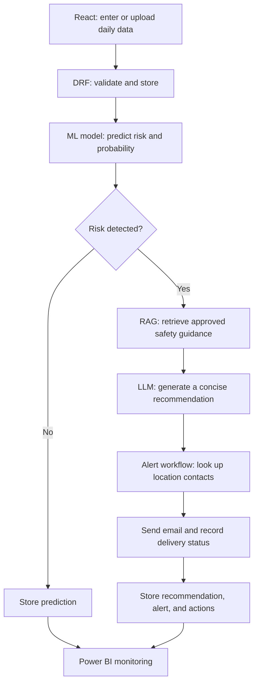

# Wayanad Landslide Early Warning & Response System

An end-to-end prototype for collecting daily landslide-monitoring data, estimating risk, sharing document-grounded safety guidance, and coordinating alerts to relevant contacts.

> **Project status:** The Django API and React app support creating, listing, updating, and deleting observations. Creating or updating a record runs the saved landslide model and stores its prediction and probability. A document-grounded safety assistant retrieves passages from `notebooks/Landslide_safety.pdf` using Pinecone and answers with Ollama. Automated alerts, agent workflows, email delivery, and Power BI dashboards remain future work.

## Project objective

Build a system that receives landslide-related testing data, predicts risk with a machine-learning model, retrieves approved safety guidance when risk is detected, and coordinates notifications. The application is organized around a React frontend, Django REST Framework (DRF) backend, operational database, and Power BI reporting.

## Observation API (implemented)

The React app has separate **New observation** and **All records** pages. Use **Edit** or **Delete** in the records table to manage an existing record. The API provides:

| Method | Endpoint | Behavior |
| --- | --- | --- |
| `GET` | `/api/observations/` | Returns every saved record as a JSON array, newest first. An empty database returns `[]`. |
| `POST` | `/api/observations/` | Validates a new reading, predicts landslide status, saves both, and returns HTTP `201 Created`. |
| `GET` | `/api/observations/{id}/` | Returns one observation. |
| `PUT` / `PATCH` | `/api/observations/{id}/` | Updates a reading, recalculates its prediction, and returns HTTP `200 OK`. |
| `DELETE` | `/api/observations/{id}/` | Deletes a reading and returns HTTP `204 No Content`. |

The **input** includes the measurements below; you do not enter a landslide outcome. The server uses the saved Logistic Regression pipeline at `notebooks/landslide_logistic_pipeline.joblib` to predict it. The model-generated `landslide_prediction` and `landslide_probability` are saved in the database and returned by GET. Older manually entered outcomes are retained as read-only `landslide_observed` history; it is not submitted for new records.

```json
{
  "location_id": 101,
  "max_temp_c": 27.5,
  "humidity_pct": 84.0,
  "wind_speed_kmh": 12.0,
  "rainfall_mm": 35.5,
  "slope_angle_deg": 32,
  "vegetation_cover": "Medium"
}
```

`vegetation_cover` must be `Low`, `Medium`, or `High`. The API also validates a positive location ID, humidity from 0 to 100, non-negative wind speed/rainfall, and slope angle from 0 to 90 degrees. The returned probability is the model's estimate for the positive (`Yes`) class; it is not a calibrated real-world risk measurement.

## Run the frontend and backend locally (Windows)

Open two terminals in VS Code. Use the project folder as the working directory in both terminals:

```powershell
cd C:\Users\91904\Desktop\ksfe\AI\CODE\Django_React_AI_project\wayanad-landslide-early-warning-system
```

### Terminal 1: start Django

Install the Python dependencies once if they are not already installed, then apply the database migrations and start Django:

```powershell
python -m pip install -r requirements.txt
python app\manage.py migrate
python app\manage.py runserver
```

The API is now available at `http://127.0.0.1:8000/api/observations/`. Django uses the SQLite database at `app/db.sqlite3` by default. To use MySQL instead, first create a database (for example `wayanad_landslide`) and set these environment variables in the same PowerShell session before running migrations and Django:

```powershell
$env:DB_ENGINE = "mysql"
$env:DB_NAME = "wayanad_landslide"
$env:DB_USER = "your_mysql_user"
$env:DB_PASSWORD = "your_mysql_password"
$env:DB_HOST = "127.0.0.1"
$env:DB_PORT = "3306"
python app\manage.py migrate
python app\manage.py runserver
```

The MySQL driver is `mysqlclient` (declared in `requirements.txt`). Django continues to use SQLite unless `DB_ENGINE=mysql` is set. Configure the browser origin with `CORS_ALLOWED_ORIGINS` if the React development server uses an origin other than `http://localhost:5173` or `http://127.0.0.1:5173`.

### Terminal 2: start React

Keep the Django terminal running. Open the second terminal at the project folder, then start Vite:

```powershell
cd frontend
npm install # first time only
npm run dev
```

Open the local URL printed by Vite (usually `http://localhost:5173`). Fill in the **Daily site reading** form and click its submit button. React sends a JSON `POST` request to Django; Django validates and saves the observation, then React refreshes the table. Vite uses `http://127.0.0.1:8000` as the API address by default. To change it, copy `frontend/.env.example` to `frontend/.env`, edit `VITE_API_BASE_URL`, and restart Vite.

The observation endpoints are implemented by `LandslideObservationViewSet` in `app/observations/views.py`; the serializer validates data and saves it to the database. The routes are configured in `app/config/urls.py`.

## Landslide safety RAG assistant

The **Safety assistant** page answers questions using passages retrieved from `notebooks/Landslide_safety.pdf`. The Django endpoint is `POST /api/safety-assistant/` with a JSON body such as:

The beginner walkthrough is [notebooks/rag.ipynb](./notebooks/rag.ipynb). It reads this PDF, explains how passages are chunked and indexed, and demonstrates retrieval and answering using the same implementation as the Django API.

```json
{
  "question": "What should I do if I hear rocks falling?"
}
```

The response contains an `answer` and the retrieved `sources`, including each source page and passage. The first question downloads the `intfloat/e5-base-v2` embedding model if it is not already cached, creates a 768-dimension Pinecone index if needed, and adds the PDF passages to a document-specific namespace. Later questions reuse the existing vectors. Restart Django after changing the PDF, embedding, Pinecone, or Ollama configuration.

### One-time setup

1. In the project root, create your local environment file from the example and add your Pinecone API key:

   ```powershell
   Copy-Item .env.example .env
   notepad .env
   ```

   Keep the real key private. The root `.env` is ignored by Git. The defaults in `.env.example` use a Pinecone serverless index in AWS `us-east-1`; update `PINECONE_CLOUD` and `PINECONE_REGION` if your Pinecone project uses another supported region.

2. In a terminal, download the local Ollama model. Ollama must be installed and running:

   ```powershell
   ollama pull qwen2.5:3b
   ```

3. Install the Python requirements if you have not already, then run the Django server as described above. Ask a question from the frontend's **Safety assistant** page. The embedding model is fetched on first use and may take a little while.

The PDF text and its embeddings are sent to Pinecone for retrieval. Do not index confidential documents unless that use is approved for your Pinecone account. If `PINECONE_API_KEY` is not set, Pinecone is unavailable, or Ollama is stopped, the API returns an explicit service error rather than an ungrounded answer. This assistant is an educational feature, not an emergency service; follow local authorities and emergency services for real incidents.

Example requests (run from PowerShell):

```powershell
$body = @{
  location_id = 101
  max_temp_c = 27.5
  humidity_pct = 84.0
  wind_speed_kmh = 12.0
  rainfall_mm = 35.5
  slope_angle_deg = 32
  vegetation_cover = "Medium"
} | ConvertTo-Json

Invoke-RestMethod -Uri http://127.0.0.1:8000/api/observations/ `
  -Method Post -ContentType "application/json" -Body $body
Invoke-RestMethod -Uri http://127.0.0.1:8000/api/observations/ -Method Get

# Replace a record; the API runs the model again using the new values.
Invoke-RestMethod -Uri http://127.0.0.1:8000/api/observations/1/ `
  -Method Put -ContentType "application/json" -Body $body

# Delete a record.
Invoke-RestMethod -Uri http://127.0.0.1:8000/api/observations/1/ -Method Delete
```

The POST response is a single JSON object, for example:

```json
{
  "id": 1,
  "location_id": 101,
  "max_temp_c": 27.5,
  "humidity_pct": 84.0,
  "wind_speed_kmh": 12.0,
  "rainfall_mm": 35.5,
  "slope_angle_deg": 32,
  "vegetation_cover": "Medium",
  "landslide_observed": null,
  "landslide_prediction": "Yes",
  "landslide_probability": 0.72,
  "created_at": "2026-10-09T09:00:00Z"
}
```

The prediction and probability shown above are examples; actual values come from the saved model. The database migration renames old `landslide` values to `landslide_observed`, preserving previously saved records.

The GET response is an array of those objects, for example:

```json
[
  {
    "id": 1,
    "location_id": 101,
    "max_temp_c": 27.5,
    "humidity_pct": 84.0,
    "wind_speed_kmh": 12.0,
    "rainfall_mm": 35.5,
    "slope_angle_deg": 32,
    "vegetation_cover": "Medium",
    "landslide_observed": null,
    "landslide_prediction": "Yes",
    "landslide_probability": 0.72,
    "created_at": "2026-10-09T09:00:00Z"
  }
]
```

To verify persistence, run the GET request again after the POST, or inspect the `observations_landslideobservation` table in the configured database. Focused API tests run with:

```powershell
python app\manage.py test observations
```

## End-to-end workflow

1. An operator enters or uploads daily testing data in the React frontend.
2. React submits the data to a DRF API.
3. DRF validates the request, stores the testing record, and passes the model features to the landslide model.
4. The model returns a prediction and probability/risk score.
5. For a no-risk result, the backend stores the prediction and finishes processing that record.
6. For a risk result, the backend retrieves relevant approved safety information and generates a concise recommendation.
7. The alert workflow identifies the affected location and retrieves its relevant emergency contacts.
8. The system sends the recommendation and risk details to those contacts by email and records the outcome.
9. Predictions, recommendations, alerts, and workflow actions are stored for monitoring and reporting.
10. Power BI reads the stored reporting data to show risk, location, trend, and alert activity.



## Architecture and responsibilities

| Component | Responsibility |
| --- | --- |
| React frontend | Enter/upload daily testing data and display predictions, risk, recommendations, and alert status. |
| Django REST Framework | Expose APIs, validate requests, coordinate prediction and response workflows, and persist results. |
| ML model | Predict landslide risk from the defined environmental/testing features. |
| RAG pipeline | Retrieve relevant passages from approved landslide safety and preparedness documents. |
| LLM | Turn retrieved context into a concise, understandable precaution or recommendation. |
| Alert agent/workflow | Look up relevant contacts, prepare and send alerts using approved tools, and record each action. |
| Database | Store locations, testing data, predictions, contacts, alerts, and workflow audit records. |
| Email service | Deliver notifications and return a delivery outcome for tracking. |
| Power BI | Present risk overview, location risk, historical trends, and alert monitoring. |

### Keep AI responsibilities distinct

- **ML** estimates landslide risk from input features.
- **RAG** retrieves information from trusted project documents.
- **LLM** generates natural-language recommendations grounded in retrieved information.
- **Agent/workflow** performs explicit actions such as contact lookup, alert preparation, email delivery, and logging.
- **DRF** validates and orchestrates the application workflow; it remains the authority for data handling and API behavior.
- **Power BI** analyzes operational data; it does not make predictions or trigger response actions.

### Jev and structured decision-making

Jev is described in this project plan as an AI model from TypeSafe AI intended primarily for structured decision-making rather than long-form text generation. If evaluated and adopted, it may support bounded structured decisions in the workflow. It does not replace the landslide prediction model, the retrieval pipeline, or the LLM's recommendation-generation role. Before integration, verify the model's current availability, capabilities, API, and suitability for the intended use; keep risk thresholds and safety-critical alert policy explicit and testable.

### Harness Engineering

Harness Engineering is the practice of building the environment around an AI agent so it can work reliably: tools, context, rules, tests, and feedback mechanisms. For this system, that means constraining agent tools to approved operations, grounding recommendations in approved sources, validating inputs and outputs, recording tool actions, testing failure paths, and requiring clear delivery status. The harness supports and limits agent behavior; it is not itself the ML model, RAG pipeline, or LLM.

## Proposed data model

| Entity | Main fields |
| --- | --- |
| `Location` | `id`, `name`, `district`, `latitude`, `longitude`, `risk_zone` |
| `TestingData` | `id`, `location_id`, `rainfall`, `soil_moisture`, `slope`, `temperature`, `timestamp` |
| `Prediction` | `id`, `testing_data_id`, `location_id`, `prediction`, `probability`, `risk_level`, `created_at` |
| `EmergencyContact` | `id`, `name`, `role`, `location_id`, `phone`, `email` |
| `Alert` | `id`, `prediction_id`, `location_id`, `message`, `sent_at`, `status` |
| `AgentExecution` | `id`, `alert_id`, `action`, `tool_used`, `status`, `executed_at` |

These are proposed entities, not a description of existing Django models. The implementation should define relationships, constraints, indexes, retention rules, and access controls as the schema is built.

## RAG and recommendation workflow

1. Collect approved landslide safety, evacuation, preparedness, and precaution documents.
2. Extract and split the documents into meaningful chunks.
3. Generate embeddings and store them with document/source metadata in a vector index.
4. For a risk prediction, build a retrieval query from the location, risk level, and relevant conditions.
5. Retrieve the most relevant chunks and pass them, with source information, to the LLM.
6. Generate a concise recommendation grounded in the retrieved context.
7. Store the recommendation and its source references with the prediction/alert record.

## Alert workflow

For a risk event, the backend should identify the affected location, retrieve its relevant contacts, and prepare an alert that includes the prediction, recommendation, and location. The email service should return a clear delivery status. Record recipients or recipient count as appropriate, tool/action details, timestamps, and failures. Avoid treating a prepared alert as a successfully delivered alert.

## Power BI dashboard plan

| Dashboard | Key information |
| --- | --- |
| Risk overview | Total predictions, high/medium/low risk counts, and today's alerts. |
| Location risk map | Locations with current risk levels and prediction values. |
| Historical trends | Daily, weekly, and monthly prediction and risk trends. |
| Alert monitoring | Alerts generated, delivery status, affected locations, and timestamps. |

Provide Power BI with a stable, appropriately permissioned reporting data source. Prefer read-only reporting access or curated views over direct access to application write operations.

## Implementation action plan

1. Finalize the landslide model, input features, prediction output, and risk-level thresholds.
2. Extend the existing Django/DRF observation API with the prediction workflow and define its request/response validation.
3. Extend the database schema with locations, predictions, contacts, alerts, and agent executions.
4. Connect and test the trained ML model in the backend.
5. Extend the existing React observation-entry/list page with prediction results and upload support.
6. Collect, approve, and organize the knowledge documents.
7. Implement document extraction, chunking, embeddings, vector storage, and retrieval.
8. Integrate an LLM to generate source-grounded precaution recommendations.
9. Define bounded agent tools for contact lookup, alert preparation, email delivery, and audit logging.
10. Connect the alert workflow to risk predictions and implement delivery-status tracking.
11. Prepare the Power BI data source and dashboards.
12. Test normal-risk and landslide-risk scenarios, including failures and unavailable services.
13. Add validation, structured logging, error handling, and audit information.
14. Document the architecture, APIs, model, RAG pipeline, agent tools, database, and dashboards.

## Development setup

### Backend

From the repository root, activate your existing Python environment, install the project dependencies if they are not installed yet, apply migrations, and run Django:

```powershell
pip install -r requirements.txt
python app\manage.py makemigrations observations
python app\manage.py migrate
python app\manage.py runserver
```

The backend project settings are in `app/config`. The observation API is available at `/api/observations/`; the broader prediction and response models remain future work.

### Frontend

In a separate terminal:

```powershell
cd frontend
npm install
npm run dev
```

The frontend includes the observation entry form and saved-record table. A production bundle can be checked with `npm run build`.

## Repository layout

```text
app/        Django project
data/       Project data (add approved datasets/documents here as appropriate)
frontend/   React and Vite application
models/     Machine-learning model assets/code
notebooks/  Exploratory and model-development notebooks
```

## Example scenario

An operator submits daily measurements for a Wayanad location. DRF validates and stores them, then calls the landslide model. If the model indicates high risk, the backend retrieves relevant approved safety guidance, generates a concise recommendation, looks up contacts for the affected location, and sends an email alert. The prediction, recommendation, alert delivery outcome, and workflow actions are saved and made available for Power BI reporting.


cd frontend
npm run dev
